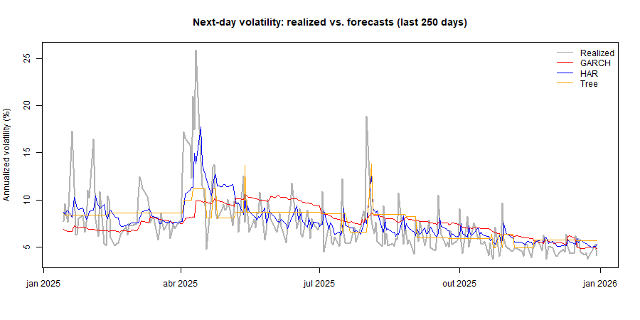

# Forecasting EUR/USD Volatility: HAR vs. GARCH vs. Regression Tree

Does intraday information improve one-day-ahead volatility forecasts, and does
nonlinearity help? This project compares three models on 5-minute EUR/USD data
(2022-2025) in a rolling out-of-sample exercise:

| Model | Input | Idea |
| --- | --- | --- |
| **GARCH(1,1)** | daily returns | next-day variance = long-run level + latest shock + previous variance |
| **HAR-RV** (Corsi, 2009) | intraday realized variance | linear regression on daily, weekly and monthly averages of realized variance |
| **Regression tree** | same three predictors as HAR | piecewise-constant forecast: average outcome of days with similar past volatility |

The tree uses the same inputs as the HAR, so any difference between them comes
from the functional form (linear vs. nonlinear). A short write-up is in
[`report/`](report/).

## Main findings

The HAR has the lowest loss under both criteria. Its advantage is statistically
significant under QLIKE, but not under squared error.

| Model | MSE | QLIKE | MZ intercept | MZ slope | MZ R² |
| --- | --- | --- | --- | --- | --- |
| GARCH(1,1) | 0.0441 | 0.2225 | 0.015 | 0.944 | 0.126 |
| **HAR-RV** | **0.0354** | **0.1813** | 0.000 | 1.012 | **0.298** |
| Regression tree | 0.0390 | 0.2068 | -0.026 | 1.118 | 0.230 |

*Out-of-sample losses (lower is better) and Mincer-Zarnowitz (MZ) regressions
of realized variance on each forecast. Variance units are %².*

Diebold-Mariano p-values (QLIKE): HAR vs. GARCH 0.043, HAR vs. tree 0.011,
GARCH vs. tree 0.458. Under MSE no pairwise difference is significant at 5%
(p = 0.17 to 0.22).

- The GARCH only sees squared daily returns, a noisy proxy for variance
  (correlation with realized variance: 0.45). It compensates with very high
  persistence (alpha + beta = 0.992, half-life of about 82 days) and adapts slowly.
- The tree does not beat the HAR: the relation between current and future
  volatility is close to linear, and a step function loses precision.
- No model anticipates the April 2025 volatility spike; they differ in how fast
  they adjust afterwards.



## How to reproduce

1. Clone the repository and open the project in RStudio (the `.Rproj` file).
2. Restore the package versions:
   ```r
   renv::restore()
   ```
3. Download the 5-minute data into `data/raw/` (requires Node.js). The folder
   must contain exactly one CSV file:
   ```bash
   npx dukascopy-node -i eurusd -from 2022-01-01 -to 2025-12-31 -t m5 -f csv -dir data/raw
   ```
4. Run the scripts in order, from the project root:
   ```bash
   Rscript 01_data_prep.R
   Rscript 02_garch.R
   Rscript 03_har.R
   Rscript 04_tree.R
   ```

| Script | What it does | Main outputs |
| --- | --- | --- |
| `01_data_prep.R` | Cleans the 5-minute bars; builds daily returns and realized variance | `data/processed/daily.rds`, descriptive tables, proxy comparison |
| `02_garch.R` | Fits GARCH(1,1) (full sample and rolling forecasts) | parameter and persistence tables |
| `03_har.R` | Fits HAR-RV (full sample and rolling forecasts) | coefficient and R² tables |
| `04_tree.R` | Fits the regression tree, then compares all three models | loss, Diebold-Mariano and Mincer-Zarnowitz tables; figures |

All tables are written to `output/tables/` and all figures to `output/figures/`.
Raw and processed data are not tracked by git.

## Method in brief

- **Data:** 5-minute EUR/USD close prices (Dukascopy). Weekends, duplicates and
  invalid prices are removed. Days with fewer than 200 bars, more than 50% zero
  returns or zero realized variance are dropped.
- **Daily series:** close-to-close return (%) and realized variance, the sum of
  squared 5-minute returns within the day (%²).
- **Forecasting:** target is next-day realized variance. Rolling window of 500
  days, re-estimated every 20 trading days, no look-ahead.
- **Evaluation:** MSE and QLIKE losses, Diebold-Mariano tests (Newey-West
  variance) and Mincer-Zarnowitz regressions.

The main settings are at the top of `R/functions.R`.

## Project structure

```
R/functions.R        shared settings and helper functions
01_data_prep.R       data cleaning and daily series
02_garch.R           GARCH(1,1)
03_har.R             HAR-RV
04_tree.R            regression tree and model comparison
output/tables/       result tables (CSV)
output/figures/      figures (PNG)
report/              short write-up
renv.lock            exact package versions
```

## Limitations

One currency pair, one period and a single window length. Six pairwise tests
are run without correction for multiple comparisons. The GARCH uses normal
innovations and the tree uses fixed settings. See the report for details.

## References

- Andersen, T. G., and Bollerslev, T. (1998). Answering the skeptics: Yes, standard volatility models do provide accurate forecasts. *International Economic Review*.
- Bollerslev, T. (1986). Generalized autoregressive conditional heteroskedasticity. *Journal of Econometrics*.
- Breiman, L., Friedman, J. H., Olshen, R. A., and Stone, C. J. (1984). *Classification and Regression Trees*.
- Corsi, F. (2009). A simple approximate long-memory model of realized volatility. *Journal of Financial Econometrics*.
- Diebold, F. X., and Mariano, R. S. (1995). Comparing predictive accuracy. *Journal of Business & Economic Statistics*.
- Patton, A. J. (2011). Volatility forecast comparison using imperfect volatility proxies. *Journal of Econometrics*.

## Author

Matheus Mafra Oliveira Andrade, MSc Quantitative Economics, Kiel University.
